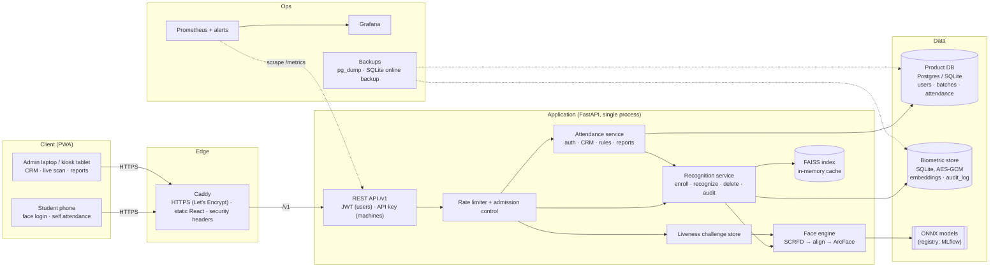
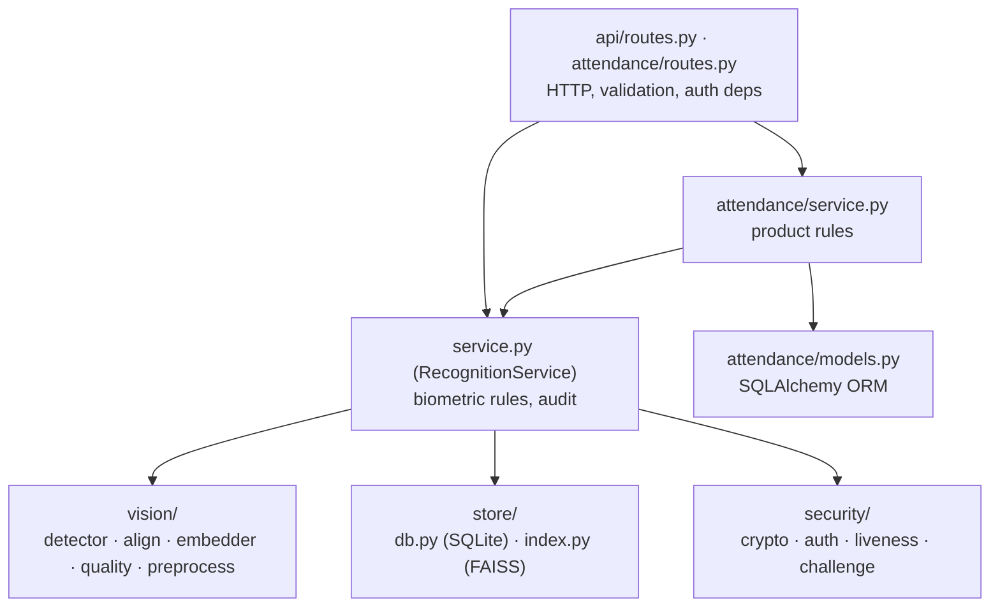
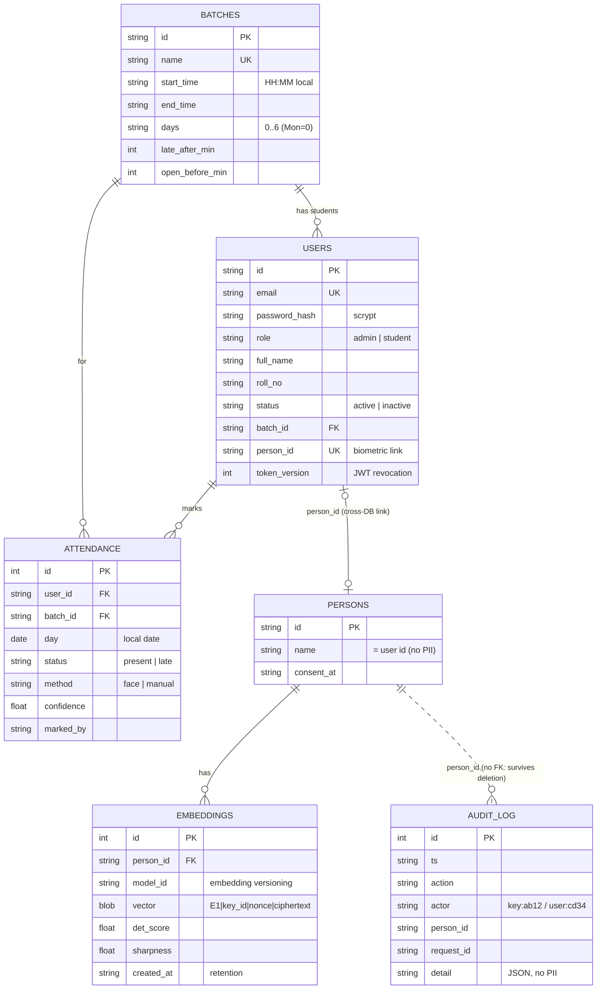
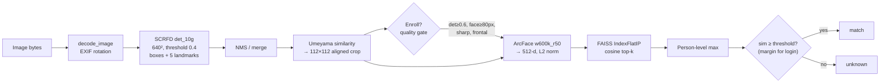
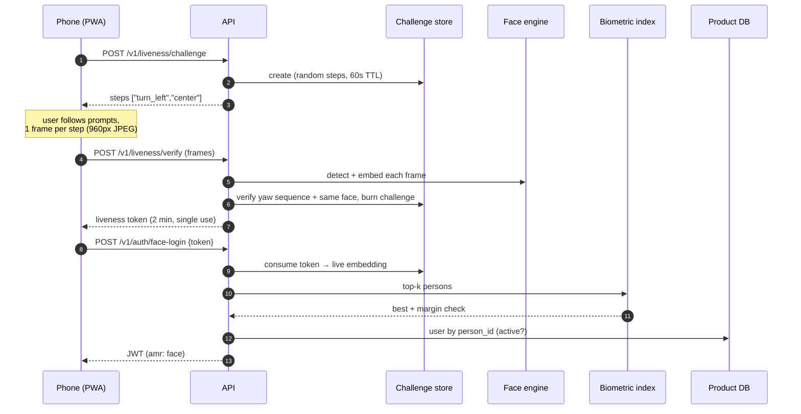
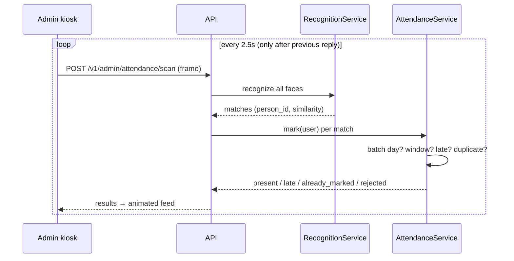

# FaceAI Pro: Architecture

> Ek jagah poora system: kaun sa hissa kya karta hai, data kahan rehta hai, ek request kaise
> chalti hai, aur scale karne pe kya badlega. Diagrams Mermaid mein hain (GitHub pe render hote hain).

## 1. System context

**Design principles**

| Principle | Kahan dikhta hai |
|---|---|
| Biometric data ko baaki data se alag rakho | Do databases; product DB mein sirf `person_id` |
| Source of truth vs cache | SQLite = truth, FAISS = startup pe rebuild hone wala cache |
| Fail closed | Prod mein keys/secret na ho to app *ready nahi hoti* |
| Model ek artifact hai, code nahi | Weights registry se (sha256-verified), image mein nahi |
| Har decision naapo | Eval pipeline (DVC), load tests, LFW experiments |

## 2. Code layers

Har layer sirf neeche wali ko jaanti hai. Isliye tests fake engine (`tests/fakes.py`) se poora API
bina GPU ke chala lete hain, aur Postgres pe jaane ke liye sirf `models.py` ka engine URL badalta hai.

## 3. Database architecture

### 3.1 Do databases kyun?

| | Product DB | Biometric store |
|---|---|---|
| Kya | naam, email, phone, batch, attendance | face embeddings (512-d), audit log |
| Tech | SQLAlchemy → SQLite (dev) / **Postgres** (prod) | SQLite (WAL) + FAISS cache |
| Encryption | Disk/volume level | **Row level AES-256-GCM**, AAD = `person_id\|model_id` |
| Access | Har API call | Sirf `RecognitionService` (audit ke saath) |
| Leak hua to | Contact data leak (bura) | Chehra badal nahi sakte, isliye extra layer |

Link: `users.person_id` ↔ `persons.id`. Product DB ke paas chehre ka data hai hi nahi.

### 3.2 Entity-relationship

**Constraints jo bugs rokte hain**

- `UNIQUE(user_id, batch_id, day)` on attendance: do kiosks ek saath mark karein to bhi duplicate
  nahi (service check + DB constraint, race-safe).
- Absent rows store nahi hote, **compute** hote hain (class days − records). Kal batch ka schedule
  badla to purane din galat "absent" nahi bante.
- `embeddings.model_id`: model upgrade ke baad purani embeddings search mein nahi aati (alag vector space).
- `audit_log` pe FK nahi: person delete ho, audit (proof of deletion) rahe.
- `PRAGMA secure_delete`: deleted embeddings disk pe zero se overwrite.
- `users.token_version`: password change / deactivate → saare purane JWT turant invalid.

**Migrations:** dev/test `create_all`; prod Alembic (`python -m faceai.attendance.migrate`).

## 4. Face recognition pipeline

| Stage | Model / algo | Measured (RTX 3050 laptop) | Kyun |
|---|---|---|---|
| Detect | SCRFD 10G, 640², thr 0.4 | 18-23 ms GPU · 141 ms CPU | Measured: 1280² misses 90% of LFW faces and is 7× slower; thr 0.4 halves missed faces |
| Align | Umeyama (5 points) | <1 ms | ArcFace ne aligned faces pe hi seekha; bina iske accuracy girti hai |
| Embed | ArcFace R50 (WebFace600K) | 10.6 ms/face (b=1) → 4.4 ms (b=16) | 512-d, cosine; LFW 99.73% (thr 0.4) |
| Search | FAISS flat inner product | <1 ms @ 10k | Exact; ~1 lakh tak flat kaafi |
| End-to-end | API, 1-face image | p50 ~42 ms (c=1) | `docs/phase-4-serving.md` |

**Thresholds (alag-alag kaam, alag risk):**

| Use | Setting | Default | Logic |
|---|---|---|---|
| Recognize / kiosk | `FACEAI_MATCH_THRESHOLD` | 0.4 | Admin supervised; galat match manual override se theek |
| Face login | `FACEAI_FACE_LOGIN_THRESHOLD` + margin 0.05 | 0.5 | Account access = strict; do log paas-paas → password maango |
| Calibration | `python -m faceai.eval.calibrate` | your data | LFW threshold (0.253) apne cameras pe transfer nahi hota |

**Phase A experiments** (`docs/phase-a-accuracy.md`): CLAHE, flip-TTA, 1280 and multi-scale were
measured on LFW and rejected (no gain, or catastrophic for 1280); they stay as config switches for
re-measuring on your own cameras.

**Liveness (active):** random 2 steps (turn left/right/center) → frames → yaw (5 landmarks) +
same-identity check → single-use token (embedding ke saath). Face login/self-attendance usi token
ke face se hota hai, alag photo nahi bhej sakte. Limits: video replay / 3D mask nahi rokta
(passive PAD model chahiye, license + evaluation ke saath).

## 5. Key flows

### Face login

### Kiosk / live attendance

## 6. Scaling path (honest limits)

Abhi design **ek API process** ke liye hai. Ye cheezein process memory mein hain:

| Component | Abhi | Multi-replica ke liye |
|---|---|---|
| Biometric store | SQLite file (volume) | Postgres + **pgvector** (ya Milvus/Qdrant), encrypted columns |
| FAISS index | In-memory, startup rebuild | Shared vector DB, ya har replica apna index + change feed |
| Liveness challenges/tokens | In-memory dict | Redis (TTL keys) |
| Rate limiter | In-memory buckets | Redis / API gateway |
| GPU | Same process | Alag inference service (Triton), batching wahan |

Pehli bottleneck GPU throughput hai (~15 req/s laptop GPU pe, Phase 4). Ek class (60 students,
kiosk 2.5s/frame) ke liye ye kaafi se zyada hai. 50+ simultaneous kiosks pe upar wala path lo.

## 7. Failure modes

| Failure | Behaviour |
|---|---|
| Model files missing / checksum mismatch | `/health/ready` = 503, load balancer traffic nahi bhejta |
| GPU fail | ORT CPU fallback (warning; `device=cuda` diya ho to fail) |
| Overload | 503 + `Retry-After` (admission control), har request slow nahi |
| Brute force login | 429 (rate limit) |
| DB file corrupt | Daily verified backups (`faceai.ops.backup`, `PRAGMA integrity_check`) |
| Encryption key lost | Embeddings unrecoverable → re-enroll (key backup alag, safe jagah) |
| Distribution drift (naye cameras) | Prometheus PSI alert → recalibrate threshold |
